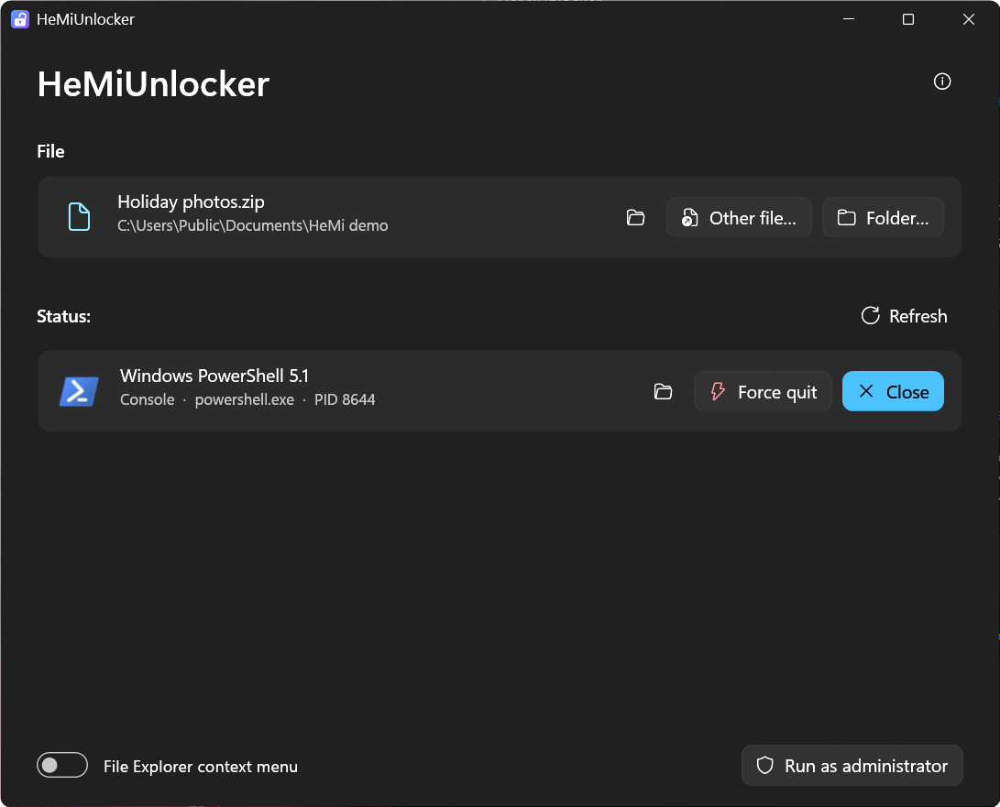

# HeMiUnlocker

[](https://github.com/Hemal1k/HeMiUnlocker/releases/latest) [](https://github.com/Hemal1k/HeMiUnlocker/releases) [](LICENSE) 

“The action can't be completed because the file is open in another program.” HeMiUnlocker shows **which program holds a
file or folder** – and closes it, nicely or by force. One small window in the look of Windows 11, English and Czech.

**[Download](https://github.com/Hemal1k/HeMiUnlocker/releases/latest)** · [Project page](https://hemal1k.github.io/hemiunlocker.html) · [Report a problem](https://github.com/Hemal1k/HeMiUnlocker/issues)



> Not signed yet – Windows SmartScreen may warn the first time (More info → Run anyway).

## Download

| File | For |
|---|---|
| `HeMiUnlocker-Setup.exe` | The installer – for the current user (no administrator), with a Start menu entry and an uninstaller. |
| `HeMiUnlocker-Portable.zip` | Just the program; run it from any folder. |

Windows 10 / 11, x64. Nothing else needs to be installed.

## Features

- **Choose** a file or folder: buttons, drag and drop onto the window, paths on the command line, or the optional item in the
  File Explorer menu.
- **See who holds it**: icon, name, kind (app, service, console, File Explorer), program, process ID, administrator or not.
- **Close** asks the program to close like its × button, so it can still save; **Force quit** ends it at once after a
  confirmation (the start time of the process is checked first, so a reused process ID is never hit).
- **File Explorer** gets **Restart** instead; protected system processes cannot be ended.
- **Run as administrator** restarts HeMiUnlocker elevated with the same files (for programs running as administrator).
- **File Explorer item** “HeMiUnlock” for files and folders – a switch in the window, off by default, written only for the
  current user.

## Building

Needs [Rust](https://rustup.rs) (stable, MSVC target) on Windows.

```
cargo build --release
```

The exe is `build\release\HeMiUnlocker.exe` (`.cargo\config.toml` sets the build folder and puts the C runtime inside the exe,
so it runs without the Visual C++ Redistributable).

`release.ps1` builds the downloads into `build\dist` (needs [Inno Setup 6](https://jrsoftware.org/isinfo.php)): the installer
(`installer\HeMiUnlocker.iss`) and the portable zip. A release published on GitHub runs the same script in
`.github\workflows\release.yml` and gets the files attached.

## Project

| File | Contents |
|---|---|
| `src\main.rs` | Start: the window, the files from the command line. |
| `src\app.rs` | The window: the chosen file, the programs that hold it and what can be done with them. |
| `src\locks.rs` | Which processes hold a file – the Restart Manager of Windows. |
| `src\procs.rs` | Processes: program path, administrator rights, icon, closing and ending them. |
| `src\shell_menu.rs` | The optional File Explorer item (`HKCU\Software\Classes`). |
| `src\theme.rs`, `src\i18n.rs` | The Windows 11 look in egui (light / dark, accent colour) and the English / Czech texts. |
| `assets` | The icon and the notices of the components. |

## License

[MIT](LICENSE).
